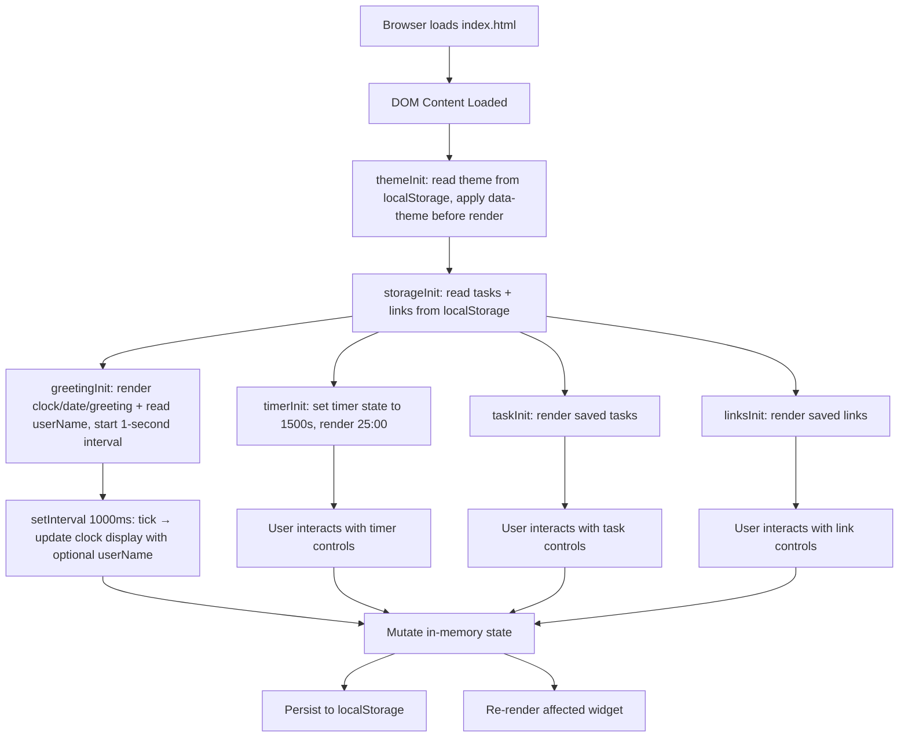
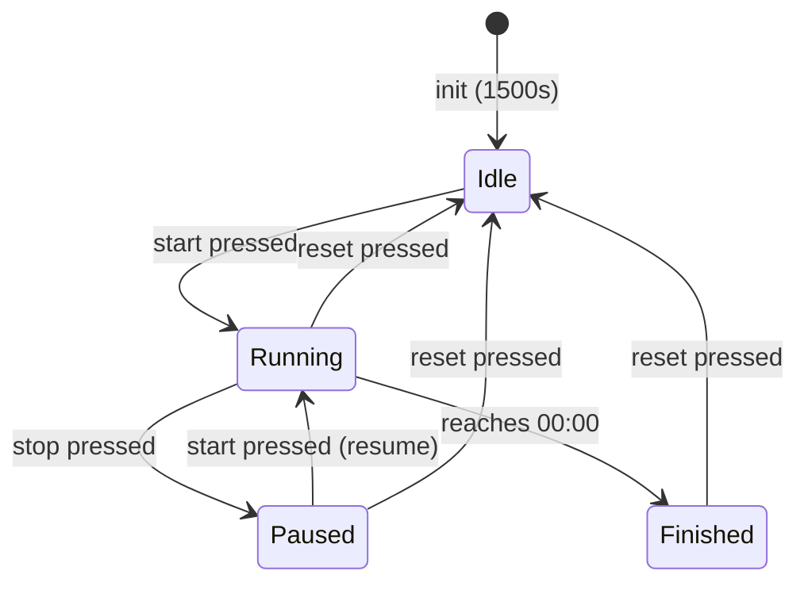

# Design Document

## Overview

The Todo List Life Dashboard is a single-page web application (SPA) built with plain HTML5, CSS3, and Vanilla JavaScript (ES6+). It requires no build tooling, no framework, and no backend — the entire application is served as static files from a file system or a simple static host, and all state is persisted exclusively via the browser's `localStorage` API.

The application is composed of four independently operating widgets rendered on one page:

| Widget | Responsibility |
|---|---|
| Greeting Widget | Live clock, date display, time-of-day greeting, and custom user name |
| Focus Timer | 25-minute Pomodoro countdown with start / stop / reset |
| Task Manager | Add, edit, complete, and delete persistent tasks |
| Quick Links | Save and launch URL shortcuts in new tabs |

All four widgets share a single HTML file, a single CSS file (`css/styles.css`), and a single JavaScript file (`js/app.js`). There is no module bundler — the JS file is loaded as a classic script.

---

## Architecture

### High-Level Structure

```
index.html          ← Single HTML page; markup for all four widgets
css/
  styles.css        ← All styles; widget layout, typography, state classes, theme variables
js/
  app.js            ← All logic; initialisation, widget controllers, storage helpers
```

### Execution Flow



### Design Principles

- **No shared mutable globals between widgets.** Each widget owns its state object; the storage layer is the only cross-cutting concern.
- **Render on mutation.** Every state change is followed immediately by a targeted DOM re-render and a `localStorage` write.
- **Progressive degradation for storage.** If `localStorage` is unavailable or contains corrupt data, widgets initialise to empty state rather than crashing.
- **No external dependencies.** The application works offline with zero network requests at runtime.
- **Theme applied before first render.** `ThemeController.init()` runs before all other widget initialisations to eliminate any flash of the wrong theme.

---

## Components and Interfaces

### Module Boundaries (logical, within one JS file)

Although everything lives in `app.js`, the code is organized into clearly separated logical sections using named closures / IIFE blocks or plain functions grouped by concern.

```
app.js
├── StorageHelper          — thin wrapper around localStorage (array data)
├── ThemeController        — theme toggle and persistence
├── GreetingController     — clock interval, greeting logic, user name
├── TimerController        — countdown state machine
├── TaskController         — task CRUD + render
├── LinkController         — link CRUD + render
└── init()                 — DOMContentLoaded bootstrap
```

---

### StorageHelper

Provides safe read/write access to `localStorage` for **array-type data** (tasks and links), absorbing `SecurityError` exceptions and JSON parse failures.

| Function | Signature | Description |
|---|---|---|
| `load` | `(key: string) → any[]` | Reads and JSON-parses the value at `key`. Returns `[]` on missing key, parse error, or storage exception. |
| `save` | `(key: string, data: any[]) → void` | JSON-serialises `data` and writes it to `key`. Silently absorbs storage exceptions. |

Storage keys managed by StorageHelper:
- `"tasks"` — array of `Task` objects
- `"links"` — array of `Link` objects

> **Note:** The scalar string keys `"theme"` and `"userName"` are managed directly via `localStorage.getItem`, `localStorage.setItem`, and `localStorage.removeItem` in their respective controllers, not through `StorageHelper`.

---

### ThemeController

Manages the visual theme toggle and persists the user's preference.

**State object:**

```js
{
  current: 'light' | 'dark'
}
```

**Public interface:**

| Function | Description |
|---|---|
| `init()` | Reads `localStorage.getItem("theme")`; if absent, defaults to `"light"`. Calls `apply(theme)` immediately — before any other widget renders — to prevent a flash of the wrong theme. |
| `toggle()` | Flips `current` between `"light"` and `"dark"`, calls `localStorage.setItem("theme", current)`, then calls `apply(current)`. |
| `apply(theme)` | Sets `data-theme="light"` or `data-theme="dark"` on the `<html>` element. All visual changes are driven by CSS; JavaScript only updates the attribute. |

**DOM targets:**
- `#theme-toggle` — toggle button

**CSS convention:**

All colors and visual theme values are defined as CSS custom properties. Theme selectors are placed on the `html` element:

```css
html[data-theme="light"] {
  --bg-color: #ffffff;
  --text-color: #111111;
  /* … */
}

html[data-theme="dark"] {
  --bg-color: #1a1a1a;
  --text-color: #f0f0f0;
  /* … */
}
```

Switching themes requires only changing the `data-theme` attribute — no inline style mutations from JavaScript.

---

### GreetingController

Manages the live clock, date string, greeting phrase, and custom user name display.

**State:**

```js
{
  userName: string   // trimmed user name, default ""
}
```

**Public interface:**

| Function | Description |
|---|---|
| `init()` | Reads `localStorage.getItem("userName")`, pre-populates `#greeting-name-input`, updates `userName` state. Performs first render immediately, then schedules `setInterval(tick, 1000)`. |
| `tick()` | Called every second; reads `new Date()`, formats time/date/greeting. If `userName` is non-empty, greeting is `"Good [Time], [UserName]"`; otherwise `"Good [Time]"`. Updates DOM nodes. |
| `saveName(name)` | Trims `name`. If non-empty: saves to `localStorage.setItem("userName", trimmed)`, updates `userName` state. If empty: calls `localStorage.removeItem("userName")`, clears `userName` state. Calls `tick()` to immediately refresh the greeting display. |

**DOM targets** (by `id`):
- `#greeting-message` — e.g., "Good Morning" or "Good Morning, Alex"
- `#greeting-date` — e.g., "Wednesday, October 22, 2026"
- `#greeting-time` — e.g., "09:14:32"
- `#greeting-name-input` — text input for the user's name
- `#greeting-name-save` — save button that triggers `saveName()`

**Greeting logic:**

| Time range | Greeting (no name) | Greeting (with name) |
|---|---|---|
| 05:00:00 – 11:59:59 | Good Morning | Good Morning, [Name] |
| 12:00:00 – 17:59:59 | Good Afternoon | Good Afternoon, [Name] |
| 18:00:00 – 20:59:59 | Good Evening | Good Evening, [Name] |
| 21:00:00 – 04:59:59 | Good Night | Good Night, [Name] |

---

### TimerController

Implements the countdown state machine.

**States:**



**State object:**

```js
{
  remaining: number,   // seconds left (0–1500)
  status: 'idle' | 'running' | 'paused' | 'finished',
  intervalId: number | null
}
```

**Public interface:**

| Function | Description |
|---|---|
| `init()` | Sets state to `{remaining: 1500, status: 'idle'}`, renders display, updates button states. |
| `start()` | Validates state is `idle` or `paused`; starts `setInterval(countdown, 1000)`. |
| `stop()` | Validates state is `running`; clears interval, sets status to `paused`. |
| `reset()` | Clears interval (if any), resets state to initial, re-renders. |
| `countdown()` | Decrements `remaining`; if `0`, clears interval, sets status to `finished`, shows completion indicator. |
| `render()` | Formats `remaining` as `MM:SS`, updates `#timer-display`; toggles disabled states on `#timer-start`, `#timer-stop`, `#timer-reset`. |

**Button enable/disable rules:**

| State | Start | Stop | Reset |
|---|---|---|---|
| idle | enabled | disabled | enabled |
| running | disabled | enabled | enabled |
| paused | enabled | disabled | enabled |
| finished | enabled | disabled | enabled |

---

### TaskController

Manages in-memory task list, DOM rendering, and persistence.

**Task object:**

```js
{
  id: string,          // crypto.randomUUID() or Date.now().toString()
  text: string,        // trimmed description (1–500 chars)
  completed: boolean
}
```

**Public interface:**

| Function | Description |
|---|---|
| `init()` | Loads tasks from `StorageHelper.load("tasks")`, renders list. |
| `add(description)` | Validates, trims, checks for duplicates, creates Task, pushes to array, persists, re-renders. |
| `edit(id, newText)` | Validates, trims, checks for duplicates (excluding the task being edited), updates Task text by id, persists, re-renders. |
| `toggleComplete(id)` | Flips `completed` flag, persists, re-renders. |
| `remove(id)` | Removes Task by id, persists, re-renders. |
| `render()` | Clears `#task-list` and rebuilds all task item elements. |

**Validation function:** `validateTask(text, currentId?)`

The optional `currentId` parameter provides edit context — when present, the duplicate check excludes the task with that id from comparison.

**Validation rules (applied in order):**

| Condition | Error message |
|---|---|
| Empty or whitespace-only after trim | "Task description cannot be empty." |
| Length > 500 chars after trim | "Task description must be 500 characters or fewer." |
| Trimmed text matches any existing task (case-insensitive; for edits, excludes `currentId`) | "A task with this description already exists." |

**Duplicate check logic:**

```js
// For add:
tasks.some(t => t.text.toLowerCase() === trimmed.toLowerCase())

// For edit (exclude the task being edited):
tasks.some(t => t.id !== currentId && t.text.toLowerCase() === trimmed.toLowerCase())
```

**DOM targets:**
- `#task-input` — text input
- `#task-add-btn` — submit control
- `#task-list` — `<ul>` container
- `#task-error` — inline validation message area

---

### LinkController

Manages in-memory link list, DOM rendering, and persistence.

**Link object:**

```js
{
  id: string,       // crypto.randomUUID() or Date.now().toString()
  label: string,    // trimmed (1–50 chars)
  url: string       // trimmed, starts with http:// or https:// (max 2048 chars)
}
```

**Public interface:**

| Function | Description |
|---|---|
| `init()` | Loads links from `StorageHelper.load("links")`, renders list. |
| `add(label, url)` | Validates both fields, trims, creates Link, pushes to array, persists, re-renders. |
| `remove(id)` | Removes Link by id, persists, re-renders. |
| `render()` | Clears `#links-list` and rebuilds all link button elements. |

**Validation rules:**

| Field | Rule | Message |
|---|---|---|
| label | non-empty after trim | "Link label cannot be empty." |
| label | ≤ 50 chars | "Link label must be 50 characters or fewer." |
| url | non-empty after trim | "URL cannot be empty." |
| url | ≤ 2048 chars | "URL must be 2048 characters or fewer." |
| url | starts with `http://` or `https://` | "URL must begin with http:// or https://." |
| count | < 20 existing links | "Maximum of 20 links reached." |

**DOM targets:**
- `#link-label-input` — label field
- `#link-url-input` — URL field
- `#link-add-btn` — submit control
- `#links-list` — container for link buttons
- `#link-label-error`, `#link-url-error` — per-field validation message areas

---

## Data Models

### Task

```js
/**
 * @typedef {Object} Task
 * @property {string}  id        - Unique identifier (UUID or timestamp string)
 * @property {string}  text      - Task description (trimmed, 1–500 chars)
 * @property {boolean} completed - Whether the task is marked complete
 */
```

Stored in `localStorage` under key `"tasks"` as a JSON array:

```json
[
  { "id": "1714000000000", "text": "Write design doc", "completed": false },
  { "id": "1714000001000", "text": "Review requirements", "completed": true }
]
```

### Link

```js
/**
 * @typedef {Object} Link
 * @property {string} id    - Unique identifier
 * @property {string} label - Display label (trimmed, 1–50 chars)
 * @property {string} url   - Full URL (trimmed, starts with http:// or https://, max 2048 chars)
 */
```

Stored in `localStorage` under key `"links"` as a JSON array:

```json
[
  { "id": "1714000002000", "label": "GitHub", "url": "https://github.com" }
]
```

### Timer State (in-memory only, not persisted)

```js
/**
 * @typedef {Object} TimerState
 * @property {number}                          remaining  - Seconds remaining (0–1500)
 * @property {'idle'|'running'|'paused'|'finished'} status - Current timer status
 * @property {number|null}                     intervalId - setInterval handle or null
 */
```

### Scalar localStorage Keys

The following keys store plain string scalars and are accessed directly via the native `localStorage` API rather than through `StorageHelper`:

| Key | Type | Controller | Read | Write | Delete |
|---|---|---|---|---|---|
| `"theme"` | `"light"` \| `"dark"` | ThemeController | `localStorage.getItem("theme")` | `localStorage.setItem("theme", value)` | — (always has a value after first toggle) |
| `"userName"` | string | GreetingController | `localStorage.getItem("userName")` | `localStorage.setItem("userName", name)` | `localStorage.removeItem("userName")` when cleared |

---

## Error Handling

### localStorage Unavailable

The `StorageHelper.load` and `StorageHelper.save` functions wrap all `localStorage` access in `try/catch`. If `localStorage` throws a `SecurityError` (e.g., in private browsing on some browsers) or is full:

- `load` returns `[]`, causing the widget to start empty.
- `save` silently fails; the in-memory state remains authoritative for the session.
- TaskController displays: "Saved tasks could not be loaded." (Requirement 3.12)
- LinkController displays: "Saved links could not be loaded." (Requirement 4.8)

`ThemeController` and `GreetingController` access `localStorage` directly; if `localStorage` is unavailable:

- `ThemeController.init()` catches any exception and falls back to applying `"light"` theme.
- `GreetingController.init()` catches any exception and proceeds with an empty `userName`.

### Corrupt JSON in localStorage

If `JSON.parse` throws on the stored value, `StorageHelper.load` catches the exception and returns `[]`. The widget starts with an empty list without crashing.

### Invalid Input

All invalid input cases are handled synchronously in the controller's `add`/`edit` functions before any state mutation. The validation message is written to the corresponding `#*-error` element and the function returns early. The error is cleared on the next successful submission.

### Timer Edge Cases

- If `start()` is called while already `running`, it is a no-op (guarded by state check).
- If `stop()` is called while not `running`, it is a no-op.
- If the page is closed while the timer is running, the remaining time is not persisted (by design — the timer is a session-only widget).

---

## Correctness Properties

These invariants must hold at all times during normal operation. Any state mutation that would violate them must be rejected before it is applied.

### Property 1: StorageHelper always returns an array

**Validates: Requirements 5.6**

`StorageHelper.load(key)` always returns an `Array` — never `null`, `undefined`, or a non-array type. `StorageHelper.save(key, data)` never throws; storage exceptions are silently absorbed.

### Property 2: ThemeController value is always a valid theme

**Validates: Requirements 8.2, 8.3, 8.5, 8.6**

`current` is always either `"light"` or `"dark"` — no other value is valid. The `data-theme` attribute on `<html>` always reflects `current` after any call to `apply()`. `init()` always completes before any other controller renders, ensuring no flash of the wrong theme.

### Property 3: GreetingController clock is always current

**Validates: Requirements 1.1, 1.2, 1.3, 1.4, 1.5, 1.6, 1.7, 9.2, 9.3, 9.4, 9.5**

The clock display is always within ±1 second of the actual wall-clock time once `init()` has run. `userName` is always a trimmed string; it is never a string of only whitespace. If `userName` is empty, the greeting never contains a trailing comma or extra whitespace. The greeting phrase is always one of: "Good Morning", "Good Afternoon", "Good Evening", "Good Night".

### Property 4: TimerController remaining is always in range

**Validates: Requirements 2.1, 2.2, 2.3, 2.4, 2.5, 2.6, 2.7, 2.8, 2.9, 2.10**

`remaining` is always an integer in the closed range `[0, 1500]`. `status` is always one of `'idle' | 'running' | 'paused' | 'finished'`. At most one `setInterval` handle is active at any time; `intervalId` correctly reflects whether a tick interval is live. `remaining` never goes below `0` (the countdown stops exactly at `0` and transitions to `'finished'`). Button enable/disable state always matches the current `status` as specified in the button rules table.

### Property 5: TaskController task list has no duplicates

**Validates: Requirements 3.1, 3.2, 3.3, 3.4, 3.5, 3.6, 3.10**

Every `Task` in the in-memory array has a unique `id`. No two tasks share the same `text` value (case-insensitive) at any point after a successful `add` or `edit`. `text` is always a non-empty trimmed string of ≤ 500 characters. `completed` is always a boolean. The rendered `#task-list` always reflects the current in-memory task array exactly after any mutation. The in-memory array and the value persisted in `localStorage` under `"tasks"` are always identical after each successful mutation.

### Property 6: LinkController link count never exceeds the cap

**Validates: Requirements 4.1, 4.2, 4.3, 4.4, 4.7, 4.9**

Every `Link` in the in-memory array has a unique `id`. `label` is always a non-empty trimmed string of ≤ 50 characters. `url` always starts with `http://` or `https://` and is ≤ 2048 characters. The link count never exceeds 20. The rendered `#links-list` always reflects the current in-memory link array exactly after any mutation. The in-memory array and the value persisted in `localStorage` under `"links"` are always identical after each successful mutation.

---

## Testing Strategy

Because the application has no build toolchain, tests are written as plain JavaScript that can be run either in a browser console or with a minimal Node.js test harness (no framework required). The strategy is organized in four layers.

### Layer 1 — Unit Tests (pure logic)

Target functions that have no DOM or `localStorage` dependency. These can be executed in Node.js directly.

| Subject | What to cover |
|---|---|
| `validateTask(text, currentId?)` | Empty input, whitespace-only, > 500 chars, case-insensitive duplicate, duplicate excluding `currentId`, valid input |
| Greeting phrase selection | Each of the four time-range boundaries (05:00, 12:00, 18:00, 21:00) and one value from each range |
| `MM:SS` timer formatting | `0 → "00:00"`, `1500 → "25:00"`, `65 → "01:05"`, `9 → "00:09"` |
| Link validation | Each of the six validation rules in the table: empty label, label > 50, empty URL, URL > 2048, bad scheme, count ≥ 20, valid input |
| `StorageHelper.load` | Missing key returns `[]`, corrupt JSON returns `[]`, valid JSON returns parsed array |
| `StorageHelper.save` | Round-trip: save then load returns the same data; no throw on `SecurityError` |

### Layer 2 — Controller State Machine Tests (mocked DOM + storage)

Provide stub implementations of `localStorage` and a minimal DOM stub. Verify state transitions without a real browser.

| Subject | Scenarios |
|---|---|
| `TimerController` state machine | `init → start → countdown to 0 → finished`; `start → stop → start (resume)`; `reset` from each non-idle state |
| `TaskController` mutations | `add` → array length increases; `toggleComplete` → flips flag; `remove` → id absent from array |
| `LinkController` mutations | `add` → array length increases; `remove` → id absent; count cap at 20 |
| `ThemeController` | `toggle` from `light` → `dark`; `toggle` from `dark` → `light`; `init` with stored `"dark"` applies dark theme |

### Layer 3 — DOM Integration Tests (browser or jsdom)

Mount the real `index.html` (or a jsdom replica) and interact via simulated events.

| Scenario | Assertion |
|---|---|
| Add a task via `#task-input` + `#task-add-btn` | Task appears in `#task-list` |
| Submit duplicate task | `#task-error` shows the duplicate message; list count unchanged |
| Click task checkbox | Item receives completed style class |
| Delete a task | Item is removed from `#task-list` |
| Add a link | Link button appears in `#links-list` |
| Add a link with invalid URL | `#link-url-error` shows the scheme message |
| Click theme toggle | `<html>` `data-theme` attribute flips |
| Save a user name | `#greeting-message` includes the name |
| Clear user name | `#greeting-message` no longer includes the name |
| Timer start → stop → reset | Display resets to `"25:00"`; start button re-enabled |

### Layer 4 — Persistence Round-Trip Tests

Verify that data survives a simulated page reload by:
1. Calling the controller's `add` or mutation function.
2. Clearing the controller's in-memory state.
3. Calling `init()` again (simulating a reload).
4. Asserting the rendered output matches the data that was saved.

Covers: tasks, links, user name, and theme preference.

### Manual / Exploratory Testing Checklist

Run in a real browser before each release:

- [ ] Open in a fresh private-browsing window; confirm all widgets load to their empty/default state.
- [ ] Add tasks and links; reload the page; confirm data persists.
- [ ] Toggle theme; reload; confirm theme is remembered.
- [ ] Enter a user name; reload; confirm greeting includes the name.
- [ ] Run the timer to completion; confirm the finished state indicator appears.
- [ ] Resize the viewport to ≤ 480 px; confirm the layout is usable on mobile.
- [ ] Disable JavaScript; confirm the page degrades gracefully (static shell visible).
- [ ] Open browser DevTools → Application → Local Storage; manually corrupt the `"tasks"` value to invalid JSON; reload; confirm the task list starts empty without a crash.
